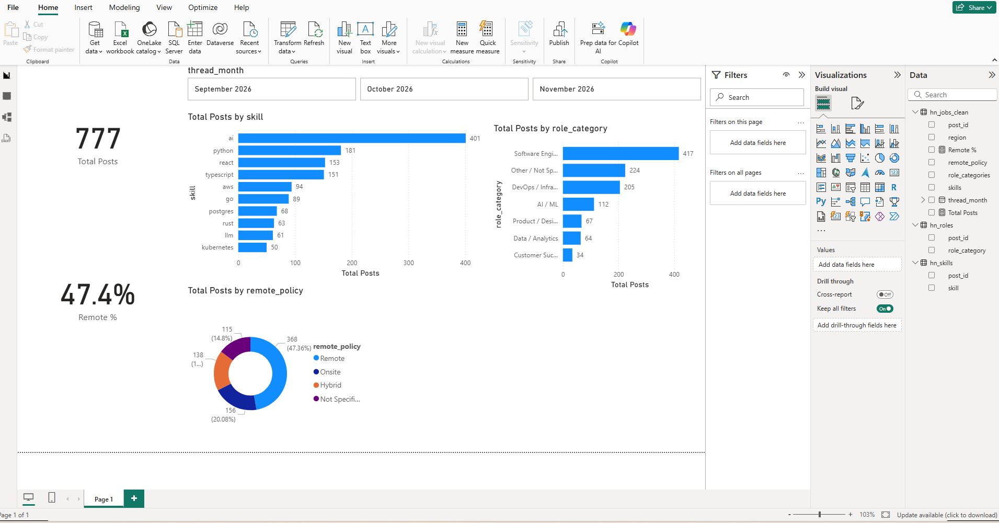

# Hacker News "Who is Hiring?" Analysis (Sep – Nov 2026)

An end-to-end data analytics project analyzing 3 months of job postings from the official Hacker News API to uncover hiring trends, remote work policies, in-demand skills, and role distributions.

## Dashboard Preview


## Project Overview
* **Data Source:** Official Hacker News Firebase API (`whoishiring` monthly threads for September, October, and November 2026).
* **Dataset Size:** 777 job posts, normalized into 1,614 skill mentions and 1,123 role mentions.
* **Privacy & Ethics:** Raw post text, author usernames, and contact details are excluded from the processed dataset and repository. Only structured attributes (month, remote policy, region, role category, and skill keywords) are stored and analyzed.

## Tech Stack & Workflow
1. **Data Collection (Python):** Queried the Hacker News API using `requests` with polite rate-limiting to collect 3 months of threads.
2. **Data Cleaning & Normalization (Python):** Stripped HTML tags using `BeautifulSoup`, extracted structured fields with regex, and normalized multi-value columns (`skills`, `role_categories`) into relational CSVs using `pandas`.
3. **Database & SQL Analysis (MySQL):** Loaded the relational tables (`jobs`, `job_skills`, `job_roles`) into MySQL and wrote analytical queries using `JOIN`, `GROUP BY`, and conditional aggregation (`sql/analysis_queries.sql`).
4. **Visualization (Power BI):** Built a relational data model with `DISTINCTCOUNT` DAX measures and interactive cross-filtering (`power_bi/hn_hiring_dashboard.pbix`). All metrics were cross-verified across Python, MySQL, and Power BI.

## Repository Structure
```text
hn-hiring-analysis/
├── data/
│   └── processed/          # Cleaned and normalized CSV files (no raw text or PII)
├── notebooks/              # Python scripts for API inspection, collection, cleaning, and normalization
├── sql/                    # Database setup and analytical SQL queries
├── power_bi/               # Power BI (.pbix) file and dashboard preview screenshot
├── insights.md             # Detailed breakdown of verified findings
└── README.md

Key Findings
Steady Remote Demand: 47.4% of all posts (368 of 777) offer remote work, holding steady between 46.9% and 47.7% across all three months.

AI Leads All Skills: AI is the #1 most requested skill overall, appearing in 51.6% of all job posts (401 of 777).

Software Engineering Dominates: Software Engineering accounts for 53.7% of all posts (417) and offers higher remote flexibility (55.2%) than the market average.

AI in Customer Success: Even within Customer Success / Support roles, AI is the top skill mentioned (22 posts), reflecting growing demand for AI-literate CX teams.

See insights.md for the full breakdown."# hn-hiring-analysis" 
